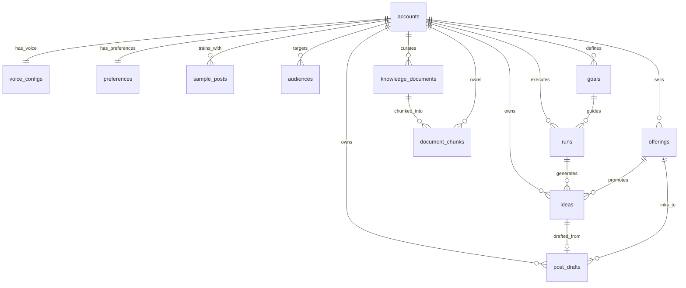

# Phase 1: Entity Relationship Document & Data Model

**Platform:** TDC AI — LinkedIn Content Generation  
**Tech Stack:** Next.js 16 (App Router), TypeScript, PostgreSQL (`pgvector`), Drizzle ORM  
**Version:** 2.0 (Final Normalized 12-Table Model)

---

## 1. Executive Summary & Architecture Philosophy

The core spine of the LinkedIn Post Generation Platform is a gated, human-in-the-loop workflow:

$$\text{Set a Goal} \longrightarrow \text{AI Agent Researches \& Ideates} \longrightarrow \mathbf{\text{Human Approval Gate}} \longrightarrow \text{Post Drafted \& Linter Verified}$$

Research and ideation are fast and exploratory; drafting is high-touch and voice-dependent. The approval gate ensures that post drafting only executes for ideas that the user explicitly approves.

---

## 2. Visual Entity Relationship Diagram (ERD)

---

## 3. Database Table Definitions

### 1. `accounts`
Stores strictly identity and public profile metadata.

| Column | Type | Constraints | Description |
| :--- | :--- | :--- | :--- |
| `id` | `uuid` | PK, default gen_random_uuid() | Unique account identifier |
| `name` | `text` | NOT NULL | Creator or brand name |
| `handle` | `text` | NOT NULL, UNIQUE | LinkedIn handle / slug |
| `headline` | `text` | NOT NULL | Professional headline |
| `bio` | `text` | NULL | Full 'About' summary |
| `avatar_url` | `text` | NULL | Profile image link |
| `account_type` | `varchar(20)` | NOT NULL, default 'personal' | `'personal'` \| `'company'` |
| `company` | `text` | NULL | Associated organization |
| `website_url` | `text` | NULL | External homepage link |
| `created_at` | `timestamptz` | NOT NULL, default now() | Creation timestamp |
| `updated_at` | `timestamptz` | NOT NULL, default now() | Update timestamp |

---

### 2. `voice_configs`
1-to-1 relationship with `accounts`. Writing style rules, tone, and banned clichés.

| Column | Type | Constraints | Description |
| :--- | :--- | :--- | :--- |
| `id` | `uuid` | PK, default gen_random_uuid() | Unique config ID |
| `account_id` | `uuid` | NOT NULL, UNIQUE, FK → `accounts(id)` ON DELETE CASCADE | 1:1 owner |
| `tone` | `varchar(50)` | NOT NULL, default 'candid' | e.g. `'candid'`, `'analytical'`, `'storyteller'` |
| `perspective` | `varchar(30)` | NOT NULL, default 'first_person' | `'first_person'` ("I/we") \| `'third_person'` |
| `formality` | `integer` | NOT NULL, default 3 | 1 (Casual) to 5 (Formal) |
| `banned_words` | `jsonb` | default '[]'::jsonb | Words/clichés to exclude |
| `rules` | `text` | NULL | Custom guidelines (line breaks, emoji limits) |
| `created_at` | `timestamptz` | NOT NULL, default now() | Creation timestamp |
| `updated_at` | `timestamptz` | NOT NULL, default now() | Update timestamp |

---

### 3. `offerings`
1-to-Many with `accounts`. Commercial products, services, or lead magnets to promote.

| Column | Type | Constraints | Description |
| :--- | :--- | :--- | :--- |
| `id` | `uuid` | PK, default gen_random_uuid() | Unique offering ID |
| `account_id` | `uuid` | NOT NULL, FK → `accounts(id)` ON DELETE CASCADE | Account owner |
| `name` | `text` | NOT NULL | Offering title (e.g. "AI MVP Sprint") |
| `type` | `varchar(30)` | NOT NULL, default 'service' | `'service'` \| `'product'` \| `'lead_magnet'` |
| `tagline` | `text` | NULL | One-line value proposition |
| `description` | `text` | NULL | Problem solved & details |
| `url` | `text` | NULL | Target CTA link |
| `is_active` | `boolean` | NOT NULL, default true | Active flag for campaign inclusion |
| `created_at` | `timestamptz` | NOT NULL, default now() | Creation timestamp |
| `updated_at` | `timestamptz` | NOT NULL, default now() | Update timestamp |

---

### 4. `sample_posts`
1-to-Many with `accounts`. Past high-performing posts for few-shot prompt conditioning.

| Column | Type | Constraints | Description |
| :--- | :--- | :--- | :--- |
| `id` | `uuid` | PK, default gen_random_uuid() | Unique sample ID |
| `account_id` | `uuid` | NOT NULL, FK → `accounts(id)` ON DELETE CASCADE | Account owner |
| `hook` | `text` | NULL | Opening 1–2 lines |
| `content` | `text` | NOT NULL | Complete post text with real `\n` line breaks |
| `tags` | `jsonb` | default '[]'::jsonb | Categorization tags (`["story", "tech"]`) |
| `is_active` | `boolean` | NOT NULL, default true | Included in prompt context |
| `created_at` | `timestamptz` | NOT NULL, default now() | Creation timestamp |

---

### 5. `audiences`
1-to-Many with `accounts`. Target reader profiles and pain points.

| Column | Type | Constraints | Description |
| :--- | :--- | :--- | :--- |
| `id` | `uuid` | PK, default gen_random_uuid() | Unique audience ID |
| `account_id` | `uuid` | NOT NULL, FK → `accounts(id)` ON DELETE CASCADE | Account owner |
| `name` | `text` | NOT NULL | Target label (e.g. "Seed-stage CTOs") |
| `pain_points` | `jsonb` | default '[]'::jsonb | Key struggles (`["Cloud cost", "Hiring"]`) |
| `goals` | `jsonb` | default '[]'::jsonb | Core objectives |
| `created_at` | `timestamptz` | NOT NULL, default now() | Creation timestamp |
| `updated_at` | `timestamptz` | NOT NULL, default now() | Update timestamp |

---

### 6. `knowledge_documents`
Ingested articles, internal notes, URLs, and summaries.

| Column | Type | Constraints | Description |
| :--- | :--- | :--- | :--- |
| `id` | `uuid` | PK, default gen_random_uuid() | Unique document ID |
| `account_id` | `uuid` | NOT NULL, FK → `accounts(id)` ON DELETE CASCADE | Account owner |
| `title` | `text` | NOT NULL | Document title |
| `source_type` | `varchar(20)` | NOT NULL | `'url'` \| `'text'` \| `'pdf'` |
| `source_url` | `text` | NULL | Origin URL if scraped |
| `content` | `text` | NOT NULL | Full extracted body text |
| `summary` | `text` | NULL | 2-sentence executive summary |
| `tags` | `jsonb` | default '[]'::jsonb | Categorization tags |
| `created_at` | `timestamptz` | NOT NULL, default now() | Creation timestamp |
| `updated_at` | `timestamptz` | NOT NULL, default now() | Update timestamp |

---

### 7. `document_chunks`
Text chunks with vector embeddings for semantic retrieval (RAG).

| Column | Type | Constraints | Description |
| :--- | :--- | :--- | :--- |
| `id` | `uuid` | PK, default gen_random_uuid() | Unique chunk ID |
| `document_id` | `uuid` | NOT NULL, FK → `knowledge_documents(id)` ON DELETE CASCADE | Parent document |
| `account_id` | `uuid` | NOT NULL, FK → `accounts(id)` ON DELETE CASCADE | Account for fast filtering |
| `chunk_index` | `integer` | NOT NULL | Sequence index (0, 1, 2...) |
| `content` | `text` | NOT NULL | ~400-word passage |
| `embedding` | `vector(1536)` | Indexed via HNSW | Vector embedding for cosine similarity |
| `created_at` | `timestamptz` | NOT NULL, default now() | Creation timestamp |

---

### 8. `goals`
Content campaign objectives.

| Column | Type | Constraints | Description |
| :--- | :--- | :--- | :--- |
| `id` | `uuid` | PK, default gen_random_uuid() | Unique goal ID |
| `account_id` | `uuid` | NOT NULL, FK → `accounts(id)` ON DELETE CASCADE | Account owner |
| `title` | `text` | NOT NULL | Goal title (e.g. "Q3 Hiring Push") |
| `objective` | `varchar(30)` | NOT NULL, default 'thought_leadership' | Objective category |
| `target_count` | `integer` | NOT NULL, default 5 | Number of approved posts needed |
| `is_active` | `boolean` | NOT NULL, default true | Active campaign flag |
| `created_at` | `timestamptz` | NOT NULL, default now() | Creation timestamp |
| `updated_at` | `timestamptz` | NOT NULL, default now() | Update timestamp |

---

### 9. `preferences`
1-to-1 with `accounts`. Cadence and pillar distribution.

| Column | Type | Constraints | Description |
| :--- | :--- | :--- | :--- |
| `id` | `uuid` | PK, default gen_random_uuid() | Unique preference ID |
| `account_id` | `uuid` | NOT NULL, UNIQUE, FK → `accounts(id)` ON DELETE CASCADE | 1:1 owner |
| `posts_per_week` | `integer` | NOT NULL, default 3 | Target posting frequency |
| `pillars` | `jsonb` | default '[]'::jsonb | Content pillars and weight percentages |
| `created_at` | `timestamptz` | NOT NULL, default now() | Creation timestamp |
| `updated_at` | `timestamptz` | NOT NULL, default now() | Update timestamp |

---

### 10. `runs`
Pipeline execution state and step logs.

| Column | Type | Constraints | Description |
| :--- | :--- | :--- | :--- |
| `id` | `uuid` | PK, default gen_random_uuid() | Unique run ID |
| `account_id` | `uuid` | NOT NULL, FK → `accounts(id)` ON DELETE CASCADE | Account owner |
| `goal_id` | `uuid` | NULL, FK → `goals(id)` ON DELETE SET NULL | Linked campaign goal |
| `workflow` | `varchar(30)` | NOT NULL | `'generate_ideas'` \| `'draft_posts'` |
| `status` | `varchar(20)` | NOT NULL, default 'pending' | `'pending'` \| `'running'` \| `'completed'` \| `'failed'` |
| `current_step` | `integer` | NOT NULL, default 0 | Step index |
| `total_steps` | `integer` | NOT NULL, default 3 | Total steps count |
| `logs` | `jsonb` | default '[]'::jsonb | Execution trace logs |
| `error` | `text` | NULL | Failure reason |
| `created_at` | `timestamptz` | NOT NULL, default now() | Run started |
| `updated_at` | `timestamptz` | NOT NULL, default now() | Run completed |

---

### 11. `ideas`
The Human Approval Gate: brainstormed angles and hooks.

| Column | Type | Constraints | Description |
| :--- | :--- | :--- | :--- |
| `id` | `uuid` | PK, default gen_random_uuid() | Unique idea ID |
| `account_id` | `uuid` | NOT NULL, FK → `accounts(id)` ON DELETE CASCADE | Account owner |
| `run_id` | `uuid` | NULL, FK → `runs(id)` ON DELETE SET NULL | Pipeline run source |
| `offering_id` | `uuid` | NULL, FK → `offerings(id)` ON DELETE SET NULL | Linked product/service |
| `hook` | `text` | NOT NULL | Opening 1–2 sentence hook |
| `angle` | `text` | NULL | Unique angle or contrarian stance |
| `pillar` | `text` | NULL | Content pillar category |
| `score` | `integer` | NOT NULL, default 80 | Predicted engagement score (1–100) |
| `status` | `varchar(20)` | NOT NULL, default 'suggested' | `'suggested'` \| `'approved'` \| `'rejected'` \| `'drafted'` |
| `created_at` | `timestamptz` | NOT NULL, default now() | Creation timestamp |
| `updated_at` | `timestamptz` | NOT NULL, default now() | Update timestamp |

---

### 12. `post_drafts`
Final drafted LinkedIn post copy ready for copying and publishing.

| Column | Type | Constraints | Description |
| :--- | :--- | :--- | :--- |
| `id` | `uuid` | PK, default gen_random_uuid() | Unique draft ID |
| `account_id` | `uuid` | NOT NULL, FK → `accounts(id)` ON DELETE CASCADE | Account owner |
| `idea_id` | `uuid` | NULL, FK → `ideas(id)` ON DELETE SET NULL | Originating approved idea |
| `offering_id` | `uuid` | NULL, FK → `offerings(id)` ON DELETE SET NULL | CTA product/service link |
| `hook` | `text` | NOT NULL | Selected opening hook |
| `body` | `text` | NOT NULL | Full post copy with real `\n` line breaks |
| `hashtags` | `jsonb` | default '[]'::jsonb | Tag list |
| `char_count` | `integer` | NOT NULL, default 0 | Character count (LinkedIn limit ~3,000) |
| `status` | `varchar(20)` | NOT NULL, default 'draft' | `'draft'` \| `'approved'` \| `'scheduled'` \| `'published'` |
| `scheduled_for`| `timestamptz` | NULL | Scheduled post date |
| `posted_at` | `timestamptz` | NULL | When user marked as posted |
| `created_at` | `timestamptz` | NOT NULL, default now() | Creation timestamp |
| `updated_at` | `timestamptz` | NOT NULL, default now() | Update timestamp |
